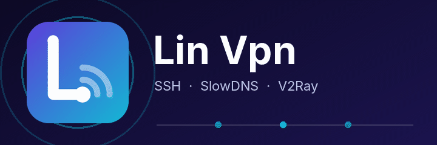

  

  

  <b>Aplikasi VPN tunneling untuk Android yang ringan, rapi, dan mudah digunakan.</b> 
  Isi akun, pilih metode, lalu sambungkan.

  
  

---

## Tentang

**Lin Vpn** membantu Anda tersambung ke internet melalui berbagai metode tunneling dengan tampilan yang bersih dan responsif, baik di ponsel maupun tablet. Semua pengaturan penting ada dalam satu aplikasi, tanpa perlu konfigurasi yang rumit.

## Fitur Unggulan

| | |
|---|---|
| **Banyak metode koneksi** | SSH WebSocket / Payload, SSH TLS, SSH SlowDNS, V2Ray, dan V2Ray SlowDNS. |
| **Manajemen profil** | Simpan banyak akun, ganti dengan satu ketukan, duplikat, ekspor, dan impor. |
| **Berbagi profil** | Bagikan lewat berkas atau tautan, dengan opsi kedaluwarsa, catatan berwarna, dan perlindungan. |
| **SlowDNS lengkap** | Pilihan tipe koneksi, name server, dan public key. |
| **Beranda informatif** | Tombol sambung, durasi, kecepatan unduh dan unggah secara langsung, IP lokal, serta pesan dari penyedia akun. |
| **Notifikasi praktis** | Tombol *Putuskan* dan *Hubungkan ulang*, lengkap dengan kecepatan terkini. |
| **Sambung ulang otomatis** | Kembali tersambung saat koneksi terputus atau jaringan berganti. |
| **Log langsung** | Gulir otomatis, mudah disalin dan dibagikan. |
| **Pengaturan lengkap** | Tema, DNS, MTU, IPv6, UDP, VPN per aplikasi, mulai otomatis, dan lainnya. |
| **Tampilan adaptif** | Nyaman di semua ukuran layar. |
| **Hemat sumber daya** | Dirancang agar tetap ringan dan halus untuk pemakaian jangka panjang. |

## Persyaratan

- Android 6.0 (Marshmallow) atau lebih baru
- Perangkat 32-bit maupun 64-bit

## Pemasangan

1. Buka halaman **[Releases](../../releases)**.
2. Unduh berkas APK yang sesuai dengan perangkat Anda:

   | Berkas | Untuk |
   |---|---|
   | `arm64-v8a` | Hampir semua ponsel terbaru (64-bit) |
   | `armeabi-v7a` | Perangkat lama (32-bit) |
   | `universal` | Bila ragu; ukuran lebih besar |

3. Buka berkas APK, lalu izinkan pemasangan dari sumber ini bila diminta.

## Memulai

1. Buka **Profil**, tambahkan akun, lalu pilih metode koneksi.
2. Kembali ke **Beranda**, pilih profil, lalu ketuk tombol sambung.
3. Pantau kecepatan dan status langsung dari Beranda atau bilah notifikasi.

## Pemberitahuan

Gunakan secara bijak dan patuhi hukum yang berlaku serta ketentuan penyedia layanan yang Anda pakai.

---

© Lin Vpn

